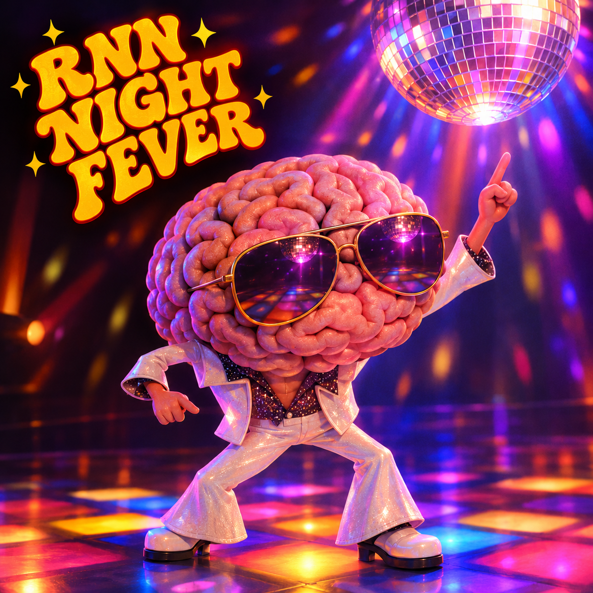

# RNN Night Fever

**Does hippocampal replay emerge when recurrent neural networks go to sleep?**



A [BrainHack Donostia 2026](https://brainhack-donostia.github.io) project (3–6 November 2026), led by Alejandro Tabas (BCBL). The full project description is in [`docs/RNN_Night_Fever_BHD2026.docx`](docs/RNN_Night_Fever_BHD2026.docx).

To perceive a noisy world, the brain needs an internal model of how its inputs are structured, but that model is too complex to learn in one go. We will build three coupled recurrent networks (perception, a fast hippocampus and a slow, high-capacity cortex), train them only to perceive well, and then let them "sleep". Our aim is to determine whether hippocampus-to-cortex replay emerges on its own during sleep, and under which conditions it does.

Existing computational models of consolidation build replay in: the modeller decides that the hippocampus will reactivate its contents during sleep and that the cortex will learn from them. We test the converse: if a system is optimised only to perceive well while awake, and is given idle time while asleep, does replay emerge by itself? And if so, what does it replay? The generative model of the world is stored in the network *states*, not the weights. Every episode samples a new world, spread over several "days" separated by sleep, and the weights are trained across episodes with backpropagation through the whole episode, so the networks learn how to learn a new world.

## Install

```bash
python -m venv .venv && source .venv/bin/activate   # Python >= 3.10
pip install -e .
```

## Quickstart

```bash
python -m rnf.train --name sleep                    # default: 3 days x (100 wake + 100 sleep) + 100 test
python -m rnf.train --name nosleep --sleep_len 0    # no-sleep baseline
python -m rnf.evaluate --name sleep --record        # test loss/acc + runs/sleep/states.npz
python -m rnf.evaluate --name nosleep
pytest                                              # smoke tests (~5 s)
```

Every field of `Config` in [`rnf/train.py`](rnf/train.py) is a CLI flag, e.g. `--h_size 16 --beta 1.0 --steps 2000`, `--alphas 0 1 2` or `--gm_kwargs '{"n_states": 16}'`. **`h_size` (hippocampal capacity) and `beta` (cortical slowness) are the main experimental knobs.** Each run writes `config.json`, `log.csv` (loss, wake loss, test loss/accuracy, penalty) and `model.pt` to `runs/<name>/`.

The default run takes ~7 min on a laptop CPU (0.4 s/step). On Apple Silicon, `--device auto` picks MPS, which is about 2× *slower* than CPU for these small step-by-step GRUs, so pass `--device cpu`.

## Team map

| Team | Owns | Starts from |
|---|---|---|
| **Team 1** — generative models | [`rnf/task.py`](rnf/task.py) | `TODO(team1)` — a GM family that genuinely needs consolidation |
| **Team 2** — architecture | [`rnf/model.py`](rnf/model.py), [`rnf/train.py`](rnf/train.py) | `TODO(team2)` — noise model, slowness penalty, lesions |
| **Team 3** — analysis & abstract | [`rnf/evaluate.py`](rnf/evaluate.py) | `TODO(team3)` — replay metrics on `states.npz` |

Find your starting points with `grep -rn "TODO(team" rnf/`.

Work in branches (one per team, e.g. `team1-gms`) and merge into `main` by pull request. Use issues to coordinate across teams, and keep `pytest` green on `main`.

## The shared interface (frozen)

Everyone codes against this. Do not change its signature or the meaning of these four keys; GMs may add extra keys.

```python
from rnf.task import sample_episode

ep = sample_episode(batch_size, n_days, wake_len, sleep_len, test_len,
                    n_tokens, gm="hmm", generator=None, **gm_kwargs)
# All tensors are (B, T), T = n_days * (wake_len + sleep_len) + test_len
ep["tokens"]     # long: clean target token at each step (0 / ignored during sleep)
ep["sleep"]      # bool: True during sleep blocks
ep["phase"]      # long: 0..n_days-1 for each day's wake block, -1 for sleep, n_days for test
ep["loss_mask"]  # bool: True on wake and test steps, False during sleep
ep["latent"]     # (HMM only) hidden GM state per step, -1 during sleep
```

Episode layout: `[day 0 wake | sleep | day 1 wake | sleep | ... | test]`. `sleep_len=0` is the no-sleep baseline. A new GM is sampled for every episode.

### Adding a new generative model

Write a function in `rnf/task.py` (or any module imported from it) and register it:

```python
@register("my_gm")
def my_gm(phase, batch_size, n_tokens, generator=None, **gm_kwargs):
    # phase: LongTensor (T,), as above. Use `generator` for all randomness.
    tokens = ...                 # LongTensor (B, T); sleep steps are overwritten with 0
    return {"tokens": tokens}    # plus any extra (B, T) tensors you want to expose
```

Then train on it with `python -m rnf.train --gm my_gm --gm_kwargs '{"param": 3}'`.

## The model in brief

- **P (perception):** a small GRU that gets `alpha * onehot(token) + sigma * noise` (alpha drawn per step from `--alphas`, 0 = missing input; all zeros during sleep) and must output the clean token.
- **H (hippocampus):** a fast GRU with limited capacity (`--h_size`).
- **C (cortex):** a larger GRU (`--c_size`) whose state maps to a stochastic latent z. A penalty β·KL(q(z_t) ‖ q(z_{t−1})) at every step, sleep included, keeps it slow.
- At each step every module receives the previous-step states of the other two (C via z), its own input and the sleep flag.
- **Loss:** cross-entropy on wake and test steps + β × mean penalty over all steps. Plain BPTT over the whole episode, never truncated across sleep.

## License

[GNU GPL v3.0](LICENSE).
